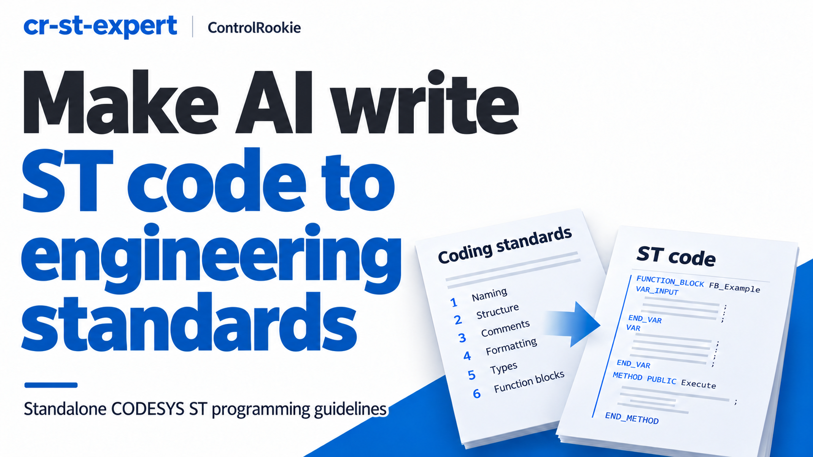
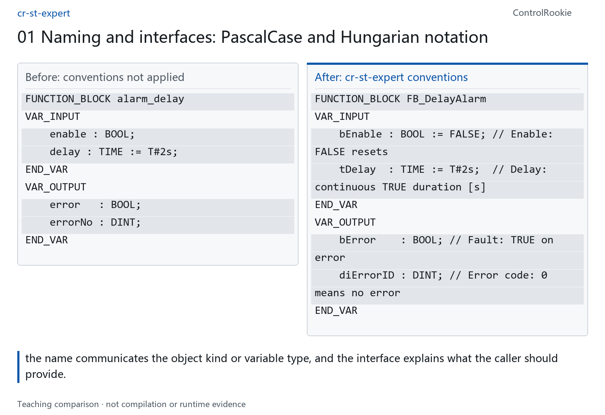
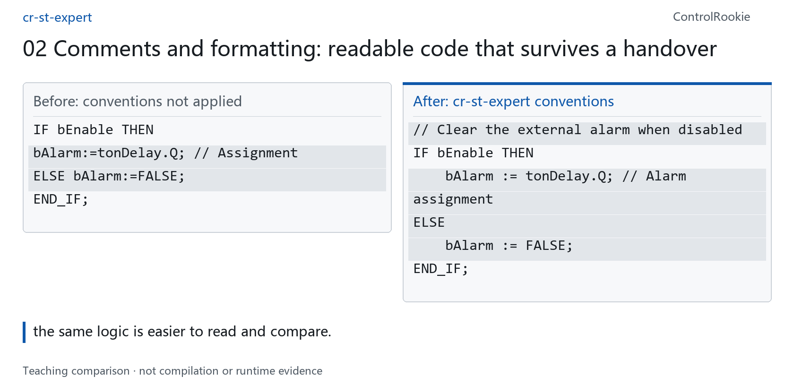
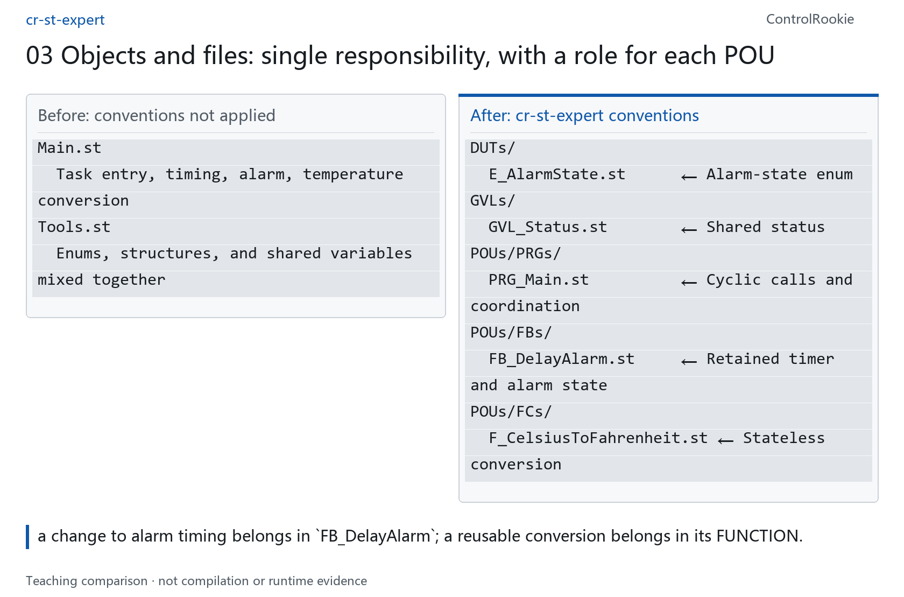
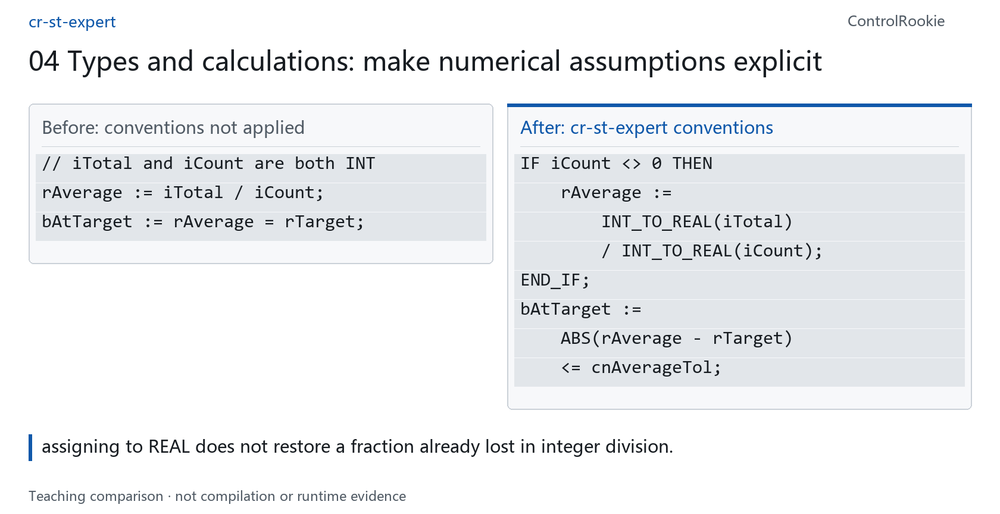
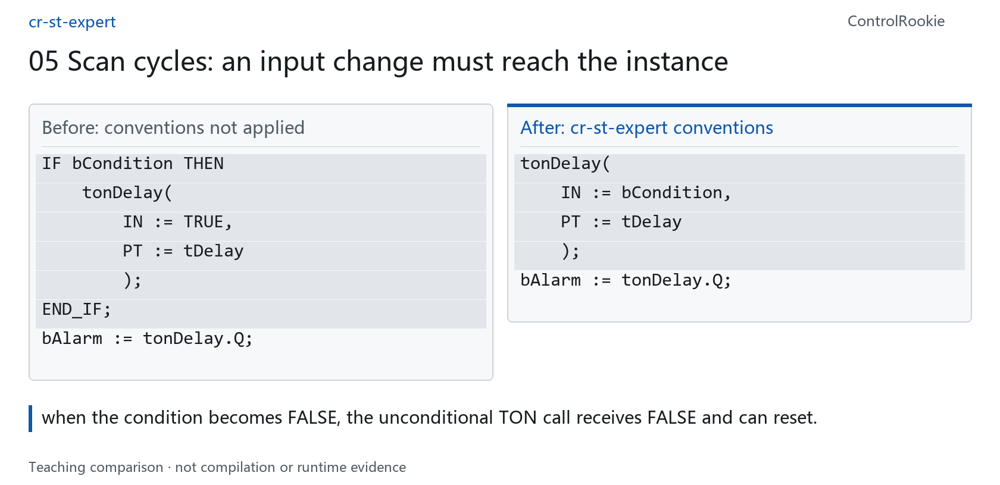
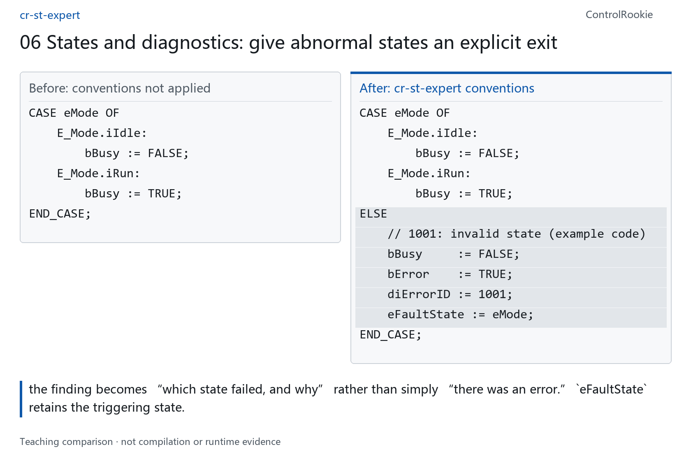
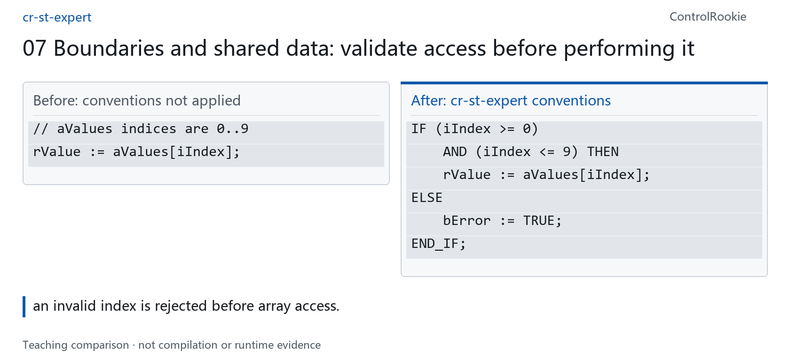
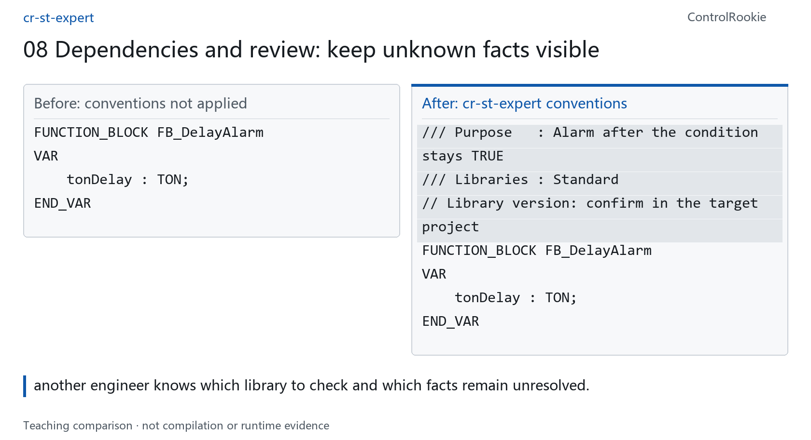

# cr-st-expert: an engineering coding handbook for your AI assistant

**English** | [简体中文](README.zh-CN.md)

> I built cr-st-expert from established programming habits, my own engineering experience, and rules for CODESYS Structured Text. Its purpose is simple: give AI a consistent engineering standard for writing, modifying, and reviewing ST code. The conventions become reusable instructions, rather than a checklist you have to reconstruct in every conversation.



In my previous introduction to SyncBridge, I showed how supported CODESYS engineering objects can be exported into files that AI and Git can work with. Engineers can inspect the changes and decide what to write back to the IDE.

Once that connection exists, a second question becomes unavoidable: **what standards should the AI follow when it changes the code?** Whether you write PLC software, lead an engineering team, or run an automation business, three familiar problems are worth considering.

1. **Experienced engineers care about the quality of the code itself.** Structure, naming, layout, and comments are part of how they think. Their best code is orderly enough that another engineer can follow its intent. I try to hold my own work to that standard, too.
2. **A company coding standard is easier to document than to apply consistently.** Templates and policy documents do not automatically make every engineer use the same conventions. When projects change hands, important knowledge can remain locked in one person's naming habits and undocumented decisions. Maintenance, staff changes, and urgent project changes expose that cost.
3. **AI-generated ST can look convincing and still need substantial correction.** You may find IDE errors, inconsistent indentation, comments that miss the point, or code that compiles but does not execute the way the requirement intended.

## What cr-st-expert is for

I organized these recurring expectations into **a coding handbook that an AI assistant can read and apply**.

**cr-st-expert is a standalone CODESYS ST programming-guidelines skill.** It gives the assistant a common basis for writing new code, modifying existing code, and explaining review findings. The goal is consistent engineering practice: clearer interfaces, more readable code, fewer avoidable mistakes, and components that are easier to maintain and reuse where appropriate.

An AI assistant can write ST without this skill. The benefit is having explicit expectations to work against, rather than hoping that each prompt produces the same conventions.

## Knowing IEC syntax is not the same as knowing the target platform

CODESYS implements IEC 61131-3 and also provides extensions beyond the standard. General ST knowledge does not establish that an assistant understands every extension, restriction, or library interface in the target environment. It may omit a constraint, borrow a convention from another platform, or invent a plausible-looking API.

**Understanding general ST does not guarantee accurate use of CODESYS-specific rules.**

cr-st-expert brings selected platform rules into the writing and review process. CODESYS documents `AND_THEN` as an IEC extension; qualified global access and strict enumerations also have specific usage requirements. [CODESYS documentation](https://content.helpme-codesys.com/en/CODESYS%20Development%20System/_cds_operator_and_then.html)

These rules have different origins. Naming and formatting choices are engineering conventions, while some checks concern standard-language behavior or platform extensions. A conversion such as `BOOL_TO_INT` should not be described as a CODESYS-only feature.

## The same requirement, with a clearer set of rules

The skill organizes its guidelines into **eight areas**. Each comparison below connects a rule to a visible change and an engineering benefit. These are prepared teaching examples, not a benchmark of two AI responses. Code snippets omit surrounding declarations and project context; the third comparison illustrates file organization.

### 01 Naming and interfaces: PascalCase and Hungarian notation

**Object names use PascalCase:** capitalize the start of each word and add the object-family prefix: `FB_DelayAlarm`, `F_CalculateAverage`, `PRG_Main`. Keep the separator after the prefix; do not turn every word boundary into another underscore.

**Variables use Hungarian-style type prefixes:** `b` for BOOL, `i` for INT, `di` for DINT, `r` for REAL, `t` for TIME, and `cn` for constants. Custom interfaces use names such as `bEnable`, `bBusy`, `bError`, and `diErrorID`. Explain input defaults, units, and reset conditions; retain fixed parameter names when calling an external library.


<picture>
  <source media="(max-width: 600px)" srcset="docs/images/rule-01-en-mobile.png">
  
</picture>

<details>
<summary>View the code / source layout</summary>

**Before**

```st before
FUNCTION_BLOCK alarm_delay
VAR_INPUT
    enable : BOOL;
    delay : TIME := T#2s;
END_VAR
VAR_OUTPUT
    error   : BOOL;
    errorNo : DINT;
END_VAR
```

**After**

```st
FUNCTION_BLOCK FB_DelayAlarm
VAR_INPUT
    bEnable : BOOL := FALSE; // Enable: FALSE resets
    tDelay  : TIME := T#2s;  // Delay: continuous TRUE duration [s]
END_VAR
VAR_OUTPUT
    bError    : BOOL; // Fault: TRUE on error
    diErrorID : DINT; // Error code: 0 means no error
END_VAR
```

</details>


**Benefit:** the name communicates the object kind or variable type, and the interface explains what the caller should provide. These are coding conventions, not proof that the earlier declaration cannot compile. Renaming an existing public interface requires a compatibility decision and coordinated caller updates.

### 02 Comments and formatting: readable code that survives a handover

**Four-space indentation and aligned columns:** use spaces rather than tabs; align declarations and named arguments; put each call argument on its own line and distinguish input `:=` from output `=>` mappings.

**Comments explain engineering intent:** use `//` and `///`, describe variable purpose and constraints, and put physical units in brackets. Explain conditions, formulas, boundaries, or failure handling where the code alone does not convey the reason. The text convention marks implementation sections with `// === IMPLEMENTATION ===`.


<picture>
  <source media="(max-width: 600px)" srcset="docs/images/rule-02-en-mobile.png">
  
</picture>

<details>
<summary>View the code / source layout</summary>

**Before**

```st before
IF bEnable THEN
bAlarm:=tonDelay.Q; // Assignment
ELSE bAlarm:=FALSE;
END_IF;
```

**After**

```st
// Clear the external alarm when disabled
IF bEnable THEN
    bAlarm := tonDelay.Q; // Alarm assignment
ELSE
    bAlarm := FALSE;
END_IF;
```

</details>


**Benefit:** the same logic is easier to read and compare. The significant comment explains why the disabled branch clears the external alarm. Assigning `tonDelay.Q` copies its current value; a short comment about setting the alarm does not mean the output is always TRUE. Formatting improvements are separate from functional verification.

### 03 Objects and files: single responsibility, with a role for each POU

**Choose the right program organization unit:** use an **FB** for behavior that retains state across scans, such as timing or latching; use a **FUNCTION** for stateless calculation, such as temperature conversion; use a **PROGRAM** for task entry and top-level coordination. Apply the single-responsibility principle instead of making the main program own every calculation, state, and diagnostic.

**Make that division visible in the source layout:** top-level objects correspond to ST files. DUTs hold enums and structures; GVLs hold shared variables; POUs are organized into FBs, FCs, and PRGs. The example separates a delay alarm from temperature conversion.


<picture>
  <source media="(max-width: 600px)" srcset="docs/images/rule-03-en-mobile.png">
  
</picture>

<details>
<summary>View the code / source layout</summary>

**Before**

```text
Main.st
  Task entry, timing, alarm, temperature conversion
Tools.st
  Enums, structures, and shared variables mixed together
```

**After**

```text
DUTs/
  E_AlarmState.st      ← Alarm-state enum
GVLs/
  GVL_Status.st        ← Shared status
POUs/PRGs/
  PRG_Main.st          ← Cyclic calls and coordination
POUs/FBs/
  FB_DelayAlarm.st     ← Retained timer and alarm state
POUs/FCs/
  F_CelsiusToFahrenheit.st ← Stateless conversion
```

</details>


**Benefit:** a change to alarm timing belongs in `FB_DelayAlarm`; a reusable conversion belongs in its FUNCTION. You can locate the responsibility without extracting a block of unrelated main-program logic. This is a source-organization convention, not executable ST. Existing IDE layouts can remain intact. The bundled exchange format groups Method, Action, and Property sections with their parent FB; it does not require native IDE objects to be merged.

### 04 Types and calculations: make numerical assumptions explicit

**Explicit conversion and range checks:** choose INT or DINT, REAL or LREAL according to the values involved. Use conversions such as `INT_TO_REAL` deliberately. Check the range before narrowing a value; a conversion call does not itself prevent overflow.

**Tolerance and division guards:** compare floating-point values using an application-appropriate tolerance rather than direct equality. Check the divisor and the boundaries of counters and unsigned-length calculations before operating on them.


<picture>
  <source media="(max-width: 600px)" srcset="docs/images/rule-04-en-mobile.png">
  
</picture>

<details>
<summary>View the code / source layout</summary>

**Before**

```st before
// iTotal and iCount are both INT
rAverage := iTotal / iCount;
bAtTarget := rAverage = rTarget;
```

**After**

```st
IF iCount <> 0 THEN
    rAverage :=
        INT_TO_REAL(iTotal)
        / INT_TO_REAL(iCount);
END_IF;
bAtTarget :=
    ABS(rAverage - rTarget)
    <= cnAverageTol;
```

</details>


**Benefit:** assigning to REAL does not restore a fraction already lost in integer division. Explicit conversion makes the intended calculation visible; the guard handles a zero divisor, and the tolerance accounts for numerical differences. Choose `cnAverageTol` from the actual units and permitted error. This fragment keeps the previous average when the count is zero; the project must decide whether that should instead clear the result or report an error.

### 05 Scan cycles: an input change must reach the instance

**Stateful calls and instance lifetime:** call TON, TOF, TP, R_TRIG, and F_TRIG consistently each scan. Keep instances in storage that retains their state, not `VAR_TEMP`. Use a separate trigger instance for each signal being monitored.

**Call first, then read the result:** read `.Q` after the call. Internal tests do not need a redundant intermediate variable merely to copy `.Q`; a meaningful public output is still appropriate. The naming rules use `ton` for TON and `rtrig` for a rising-edge trigger.


<picture>
  <source media="(max-width: 600px)" srcset="docs/images/rule-05-en-mobile.png">
  
</picture>

<details>
<summary>View the code / source layout</summary>

**Before**

```st before
IF bCondition THEN
    tonDelay(
        IN := TRUE,
        PT := tDelay
        );
END_IF;
bAlarm := tonDelay.Q;
```

**After**

```st
tonDelay(
    IN := bCondition,
    PT := tDelay
    );
bAlarm := tonDelay.Q;
```

</details>


**Benefit:** when the condition becomes FALSE, the unconditional TON call receives FALSE and can reset. Skipping a call is not equivalent to executing it with a reset input. The outer object must also be called cyclically; actual timing still depends on the task and call arrangement. [TON documentation](https://content.helpme-codesys.com/en/libs/Standard/Current/Timer/TON.html)

### 06 States and diagnostics: give abnormal states an explicit exit

**Strict enums and qualified names:** express states through enums with `strict` and `qualified_only`. Members of an INT-based enum use the `i` prefix, for example `E_Mode.iRun`; explicit values are unique, and enum values are not casually mixed with integer arithmetic.

**Diagnosable state machines:** include a CASE fallback, separate entry actions from continuous actions, and consider timeouts when waiting for feedback. Use `bError` and `diErrorID`, retain the triggering state and relevant inputs, and do not clear a fault blindly while its cause remains.


<picture>
  <source media="(max-width: 600px)" srcset="docs/images/rule-06-en-mobile.png">
  
</picture>

<details>
<summary>View the code / source layout</summary>

**Before**

```st before
CASE eMode OF
    E_Mode.iIdle:
        bBusy := FALSE;
    E_Mode.iRun:
        bBusy := TRUE;
END_CASE;
```

**After**

```st
CASE eMode OF
    E_Mode.iIdle:
        bBusy := FALSE;
    E_Mode.iRun:
        bBusy := TRUE;
ELSE
    // 1001: invalid state (example code)
    bBusy     := FALSE;
    bError    := TRUE;
    diErrorID := 1001;
    eFaultState := eMode;
END_CASE;
```

</details>


**Benefit:** the finding becomes “which state failed, and why” rather than simply “there was an error.” `eFaultState` retains the triggering state. Error code 1001 is an illustrative project code, not a vendor-defined error. The complete enum, error-latching, and reset behavior still need a real design.

### 07 Boundaries and shared data: validate access before performing it

**Defensive programming:** check array indices, string capacity, and pointer validity, length, and lifetime. Ordinary AND is not a short-circuit pointer guard; use a verified short-circuit expression such as `AND_THEN` where appropriate.

**Ownership and synchronization:** do not concurrently call the same FB instance from multiple tasks. Define who writes shared data and how consistency is maintained. `VAR_IN_OUT` is suitable for passing large structures by reference, but reference passing is not a synchronization mechanism.


<picture>
  <source media="(max-width: 600px)" srcset="docs/images/rule-07-en-mobile.png">
  
</picture>

<details>
<summary>View the code / source layout</summary>

**Before**

```st before
// aValues indices are 0..9
rValue := aValues[iIndex];
```

**After**

```st
IF (iIndex >= 0)
    AND (iIndex <= 9) THEN
    rValue := aValues[iIndex];
ELSE
    bError := TRUE;
END_IF;
```

</details>


**Benefit:** an invalid index is rejected before array access. This particular example shows index protection, not a complete cross-task safety design. It leaves the previous output value on the invalid branch; clearing the error and handling invalid output values require an explicit project convention.

### 08 Dependencies and review: keep unknown facts visible

**A library-dependency contract:** identify actual libraries as `LibraryId` or `LibraryId@Version`, separating multiple dependencies with semicolons. State when there are no external libraries; mark an unknown version for confirmation rather than inventing a function, parameter, or version number.

**A review with a defined scope:** report the reviewed files, the location and reason for a finding, the suggested change, and anything that cannot be confirmed. A snippet review supports a snippet-level conclusion. Human review, optional scripts, compilation, and functional testing are distinct checks.


<picture>
  <source media="(max-width: 600px)" srcset="docs/images/rule-08-en-mobile.png">
  
</picture>

<details>
<summary>View the code / source layout</summary>

**Before**

```st before
FUNCTION_BLOCK FB_DelayAlarm
VAR
    tonDelay : TON;
END_VAR
```

**After**

```st
/// Purpose   : Alarm after the condition stays TRUE
/// Libraries : Standard
// Library version: confirm in the target project
FUNCTION_BLOCK FB_DelayAlarm
VAR
    tonDelay : TON;
END_VAR
```

</details>


**Benefit:** another engineer knows which library to check and which facts remain unresolved. A dependency declaration does not prove that the library is installed, the signature is correct, or the code compiles. This example shows only the declaration area.

That is how the handbook becomes practical: its expectations are visible in names, interfaces, comments, organization, and execution checks. The code becomes easier to read, compare, modify, and maintain.

## How to use it

A skill is a set of instructions and supporting resources that an AI coding assistant can read. cr-st-expert includes an entry point, detailed rules, templates, and examples. Keep the whole directory rather than copying only `SKILL.md`.

Install it in a skill location supported by your assistant, then confirm that `cr-st-expert` and its referenced resources are loaded. Basic use does not require Python, a CLI, a graph service, or a motion-control skill. The bundled checking scripts are optional.

**Write code**

> Use cr-st-expert to write a function block for [requirements]. The inputs, outputs, and operating conditions are [details]. Identify missing information before making assumptions. Respond in English.

**Modify code**

> Use cr-st-expert to improve this code while preserving its public interfaces and intended behavior. Explain the changes, and propose behavior changes separately before applying them.

**Review code**

> Review this code using cr-st-expert. Report the location, reason, and suggested change for each finding. Do not edit the code. List anything that cannot be confirmed.

## How it works alongside SyncBridge

Export supported objects with SyncBridge → ask AI to review or modify them using cr-st-expert → inspect the differences in Compare → approve what is written back to the IDE → compile and test the behavior.

SyncBridge handles object synchronization; cr-st-expert provides coding guidelines and a basis for review. You can also provide a snippet directly to an AI assistant without using SyncBridge. Neither product is required to install the other.

## It is not a compiler, and it does not promise zero errors

**cr-st-expert helps make code more consistent and reduce avoidable errors. It does not guarantee that every result will be error-free.** An assistant may miss a finding or misunderstand a requirement, and the skill does not cover every compiler version, library, or application scenario.

It does not provide complete knowledge of the CODESYS library ecosystem, connect to devices, simulate, or download a program. Compile in the target environment, verify the required behavior, and have an engineer review the result.

A coding-guidelines review, a successful build, and a correct application are separate conclusions. None should stand in for the others.

## About this series

The preceding SyncBridge introduction explains how CODESYS engineering objects can enter an AI workflow and how engineers retain control of the changes written back. This article adds the programming-guidelines layer. The companion demonstration covers installation, review, and modification using the same examples.

## Sharing the skill

I am sharing cr-st-expert as an open-source skill. Download the full directory and follow the repository's deployment instructions.

Start with a function block you already understand. Ask for a review, decide whether the findings are valid, and check that the proposed changes preserve the intended function. Feedback on conflicting rules, missed findings, and better examples will help improve the handbook.

SyncBridge brings engineering code into the AI workflow; cr-st-expert brings the programming expectations with it. My aim is to reduce repeated explanations and make the resulting code easier to understand and maintain.

## Download and installation

[Download the standalone ZIP](https://github.com/BenPeng0205/cr-st-expert/raw/refs/heads/main/downloads/cr-st-expert-4.0.0-standalone.zip) · [Deployment guide](deploy/README.md) · [MIT license](LICENSE)

Keep `SKILL.md` directly inside the `cr-st-expert` folder, alongside its supporting directories. Most detailed rules are currently in Chinese; this homepage is an English product introduction, not a complete English localization of the rule library.

Repository and local checks are not independent clean-machine acceptance. That acceptance is still incomplete, so package metadata retains `NOT_RELEASE_ELIGIBLE`; this publication shares source and rules without claiming production-release certification.
