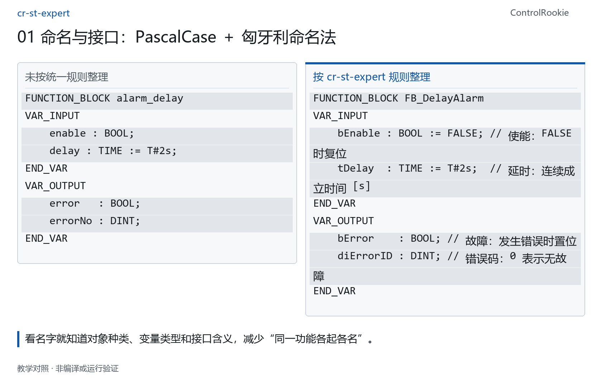
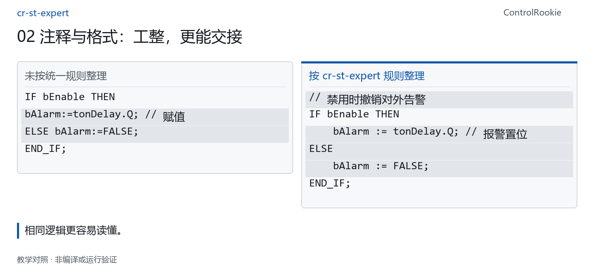
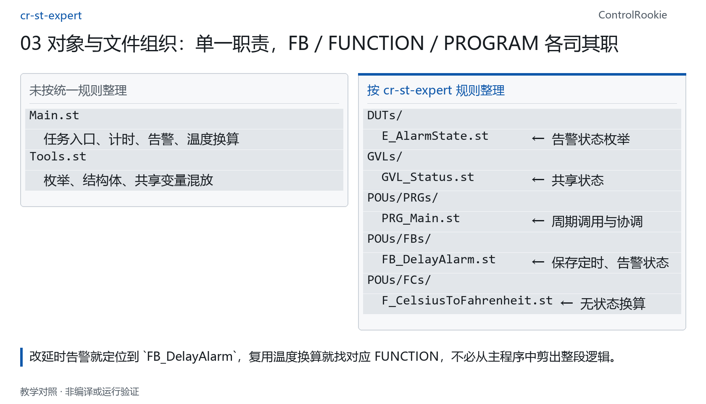
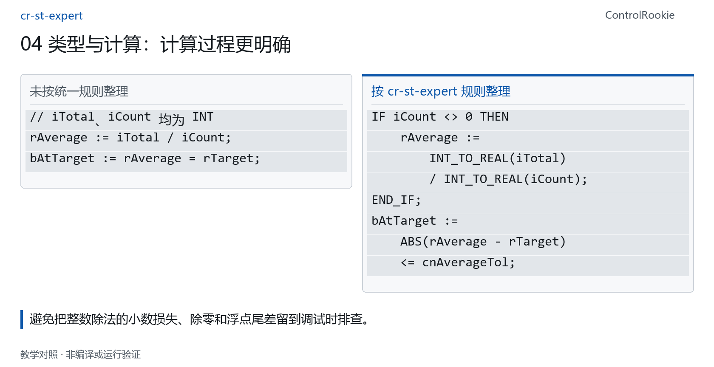
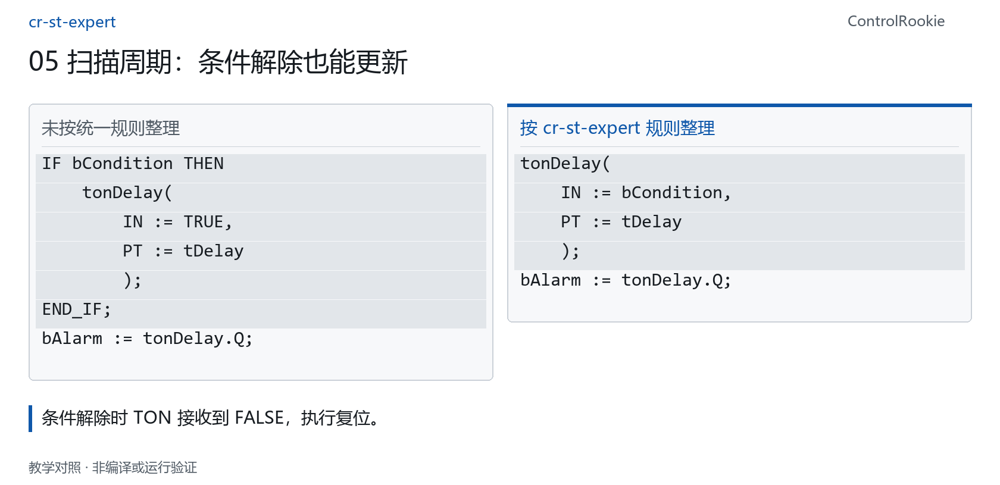
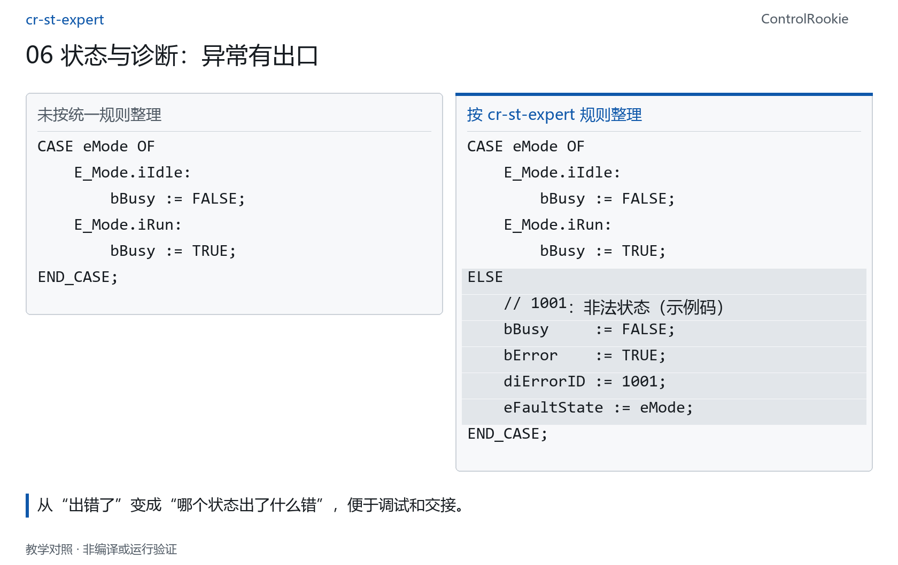
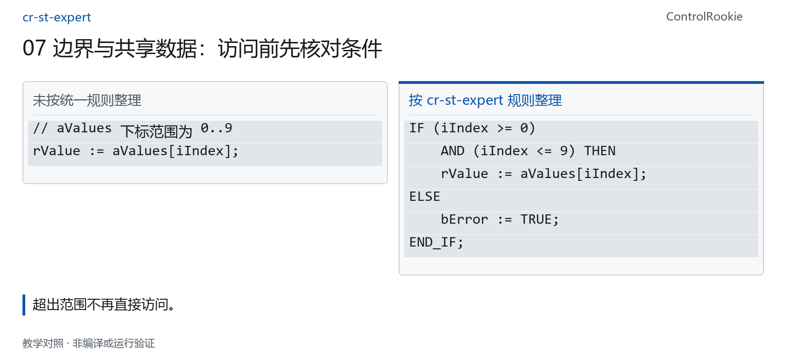
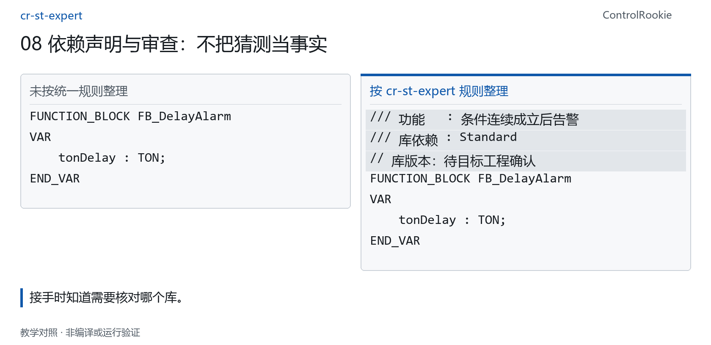

# cr-st-expert：一本给 AI 看的《企业级ST标准化编程规范手册》

[English](README.md) | **简体中文**


> **摘要**
> 我基于国际通用习惯、个人的经验以及适合CodeSys ST编程的规则等整理成了 cr-st-expert。它要做的事，就是封面上的这句话：让AI按照工程师级规范和标准写ST代码。用大白话说，没有这个技能，AI 也照样能写 ST；有了这套资料，AI 能够按照工程师级的统一标准、高质量、更准确、可复用地完成代码编写、修改和检查。


上一篇介绍的 SyncBridge，让 CODESYS 工程代码进入 AI 工作流，它把 CODESYS 工程里受支持的对象导出成 AI 和 Git 能读懂的文件，让工程师看清修改差异，再决定哪些内容写回 IDE，让代码写回达到“工程师级的安全、可控”。

工程和 AI 的工作流连接起来以后，不管你是自动化工程师，还是技术部门负责人，亦或是公司的老板，以下三个非常实际的问题，你是否认真思考过：

1. 很多资深或经验丰富的自动化工程师，通常都有或多或少的“代码洁癖”，不论你使用文本语言还是图形化语言，他们都对程序结构、代码工整、注释、变量命名等的规范都有近乎“偏执”的迷恋和坚持！**大佬之所以是大佬，他们的代码就像状元的卷面，整洁得让人舍不得打勾！就像蜜蜂的蜂巢，结构规整得令人肃然起敬！**首先我自豪地承认，我一直严格要求我自己向大佬看齐，其次我坚信只有这样追求才能练就非凡的代码能力。

2. 在我走访咨询过的这么多声称将要或者已经在推动全方位“企业标准化”落地的公司中，很长时间过去了，就连推动程序代码标准化都磕磕绊绊、举步维艰。有多少推动标准化的负责人抱怨着“我们公司为了推动标准化，有模板、有文件、有规定，什么都有，但张工、李工、王工都各个阳奉阴违，现在程序功能迭代、人员离职接手程序全都是头疼的问题，那个xx工写的程序自带‘加密’功能，换了谁都看不懂，这个项目实施周期紧张得不得了，最后实在没办法，又花了几个w的冤枉钱把他请过来先把这个项目应付过去”……诸如此类。

3. 如果你已经使用过AI来进行ST代码辅助编程，你一定会发现**AI 写出来的代码，看起来像 ST，写回 CODESYS IDE 后却各种报错，或者即便编译通过了，执行逻辑仍然不对、注释永远不满足我的要求、缩进换行五花八门……怎么办？**

## cr-st-expert的作用

针对以上实际的问题和痛点，我基于大佬的习惯、个人的经验以及适合CodeSys平台ST编程的规则等整理成了 cr-st-expert。

**cr-st-expert 是一套独立的 CODESYS ST 编程规范技能：它就是按照极高的工程级标准和要求整理出来的一本给AI看的《企业级ST标准化编程规范手册》，让 AI 写代码、改代码、审查代码时有规则可查。**

用大白话说，没有这个技能，AI 也照样能写 ST；有了这套资料，AI 能够按照工程师级的统一标准、高质量、更准确、可复用地完成代码编写、修改和检查。

## 懂 IEC 标准，还要懂 CODESYS 的平台规则

首先希望大家能了解，CODESYS 毫无疑问实现并满足 IEC 61131-3 标准，同时在标准之外，还有很多语法、关键字等是平台或者厂家独有的拓展。因此，AI就算已经完全吃透IEC61131-3标准，但是它对各个平台或厂家的独有的知识和规则是没有完整认知的！这就导致了前面提到的”AI看似会写ST“的幻觉，当遇到这些拓展规则和知识的时候，AI很可能出现遗漏、混用、乱编的情况，最终导致代码写回IDE出现报错。

因此，**懂通用 ST，不等于能准确使用 CODESYS 的全部语法和平台规则。** 

cr-st-expert 将 CODESYS 平台工程规范与已整理的部分平台规则明确交给 AI，让生成、修改和审查有据可查。例如，`AND_THEN` 是 CODESYS 文档明确标注的标准扩展；全局变量的限定访问、严格枚举等，也有具体使用限制。[CODESYS 官方说明](https://content.helpme-codesys.com/en/CODESYS%20Development%20System/_cds_operator_and_then.html)

## 同样的功能，按规范写出来有什么不同？

cr-st-expert一共对**八类规则**进行了总结，下面就带大家看一看，每一类规则**约定什么、使用前后代码怎样变化、工程师得到什么，一起对照。**

### 01 命名与接口：PascalCase ＋ 匈牙利命名法

**对象用 PascalCase（帕斯卡命名法）：** 每个单词首字母大写，配合类型前缀，例如 `FB_DelayAlarm`、`F_CalculateAverage`、`PRG_Main`。前缀后只保留一个分隔下划线，不写成 `FB_Delay_Alarm`。

**变量用匈牙利命名法：** 类型前缀小写、后续单词首字母大写，例如 BOOL 用 `b`、INT 用 `i`、DINT 用 `di`、REAL 用 `r`、TIME 用 `t`，常量统一用 `cn`。自定义接口统一为 `bEnable`、`bBusy`、`bError`、`diErrorID` 等；输入说明安全默认值、单位和边界，外部库固定参数保留原名。

<picture>
  <source media="(max-width: 600px)" srcset="docs/images/rule-01-zh-mobile.png">
  
</picture>

<details>
<summary>查看代码／文件结构（可复制）</summary>

**未按规范整理｜用途要靠猜**

```st before
FUNCTION_BLOCK alarm_delay
VAR_INPUT
    enable : BOOL;
    delay : TIME := T#2s;
END_VAR
VAR_OUTPUT
    error   : BOOL;
    errorNo : DINT;
END_VAR
```

**按 cr-st-expert 整理｜接口含义明确**

```st
FUNCTION_BLOCK FB_DelayAlarm
VAR_INPUT
    bEnable : BOOL := FALSE; // 使能：FALSE 时复位
    tDelay  : TIME := T#2s;  // 延时：连续成立时间 [s]
END_VAR
VAR_OUTPUT
    bError    : BOOL; // 故障：发生错误时置位
    diErrorID : DINT; // 错误码：0 表示无故障
END_VAR
```

</details>

**收益：** 看名字就知道对象种类、变量类型和接口含义，减少“同一功能各起各名”。这是统一命名的工程约定；修改已有公共接口时，要先确认兼容性并同步调用方。

### 02 注释与格式：工整，更能交接

**四空格缩进与列对齐：** 禁止 Tab，变量声明的 `:`、`:=`、注释按块对齐；命名参数一行一个，输入 `:=` 和输出 `=>` 对齐。

**工程语义注释：** 使用 `//`、`///`，变量注释采用“概括：说明”，物理单位用 `[unit]`；关键逻辑交代工况、公式、边界或异常原因，不机械翻译每行代码。实现区统一标记为 `// === IMPLEMENTATION ===`。

<picture>
  <source media="(max-width: 600px)" srcset="docs/images/rule-02-zh-mobile.png">
  
</picture>

<details>
<summary>查看代码／文件结构（可复制）</summary>

**未按规范整理｜逻辑挤在一起**

```st before
IF bEnable THEN
bAlarm:=tonDelay.Q; // 赋值
ELSE bAlarm:=FALSE;
END_IF;
```

**按 cr-st-expert 整理｜说明实际工况**

```st
// 禁用时撤销对外告警
IF bEnable THEN
    bAlarm := tonDelay.Q; // 报警置位
ELSE
    bAlarm := FALSE;
END_IF;
```

</details>

**收益：** 相同逻辑更容易读懂。前版的问题是可读性，不是功能一定错误。

### 03 对象与文件组织：单一职责，FB／FUNCTION／PROGRAM 各司其职

**先选对程序单元（POU）：** 定时、锁存等需要跨周期保存状态的功能用 **FB**；温度换算等无状态计算用 **FUNCTION**；**PROGRAM** 负责顶层任务入口和协调。按**单一职责原则**组织，避免一个主程序把计算、状态、诊断全部包办。

**再把职责落实到文件：** 顶层对象与 ST 文件一一对应；DUTs 放枚举和结构体，GVLs 放共享变量，POUs 下分别组织 FBs、FCs、PRGs。下面用“延时告警＋温度换算”看文件怎样变化。

<picture>
  <source media="(max-width: 600px)" srcset="docs/images/rule-03-zh-mobile.png">
  
</picture>

<details>
<summary>查看代码／文件结构（可复制）</summary>

**未按规范整理｜职责和文件混在一起**

```text
Main.st
  任务入口、计时、告警、温度换算
Tools.st
  枚举、结构体、共享变量混放
```

**按 cr-st-expert 整理｜每个对象有明确职责**

```text
DUTs/
  E_AlarmState.st      ← 告警状态枚举
GVLs/
  GVL_Status.st        ← 共享状态
POUs/PRGs/
  PRG_Main.st          ← 周期调用与协调
POUs/FBs/
  FB_DelayAlarm.st     ← 保存定时、告警状态
POUs/FCs/
  F_CelsiusToFahrenheit.st ← 无状态换算
```

</details>

**收益：** 改延时告警就定位到 `FB_DelayAlarm`，复用温度换算就找对应 FUNCTION，不必从主程序中剪出整段逻辑。这是源码文本组织建议，既有 IDE 工程可保留原布局；内置交换格式将 Method、Action、Property 聚合在父 FB 中，不是要求在 IDE 中把所有对象合成一个。

### 04 类型与计算：计算过程更明确

**显式类型转换与数值边界：** 选择符合范围的 INT／DINT、REAL／LREAL，用 `INT_TO_REAL` 等明确转换；窄化转换先检查范围，不能把转换函数当作防溢出保护。

**浮点容差与除零保护：** REAL／LREAL 不直接用相等判断，改用 `ABS(差值) <= 容差`；除法先检查除数，计数和无符号长度运算先检查上下限。

<picture>
  <source media="(max-width: 600px)" srcset="docs/images/rule-04-zh-mobile.png">
  
</picture>

<details>
<summary>查看代码／文件结构（可复制）</summary>

**未按规则核对｜整数先除，再赋给 REAL**

```st before
// iTotal、iCount 均为 INT
rAverage := iTotal / iCount;
bAtTarget := rAverage = rTarget;
```

**按 cr-st-expert 整理｜先转 REAL，再检查除数**

```st
IF iCount <> 0 THEN
    rAverage :=
        INT_TO_REAL(iTotal)
        / INT_TO_REAL(iCount);
END_IF;
bAtTarget :=
    ABS(rAverage - rTarget)
    <= cnAverageTol;
```

</details>

**收益：** 避免把整数除法的小数损失、除零和浮点尾差留到调试时排查。`cnAverageTol` 应按实际单位和精度确定；除数为零时示例保留原值，实际工程须约定是否清零或报错。

### 05 扫描周期：条件解除也能更新

**状态型功能块与实例生命周期：** TON／TOF／TP、R_TRIG／F_TRIG 每扫描周期稳定调用，实例放在能保持状态的 `VAR`，不放 `VAR_TEMP`。一个被检测信号对应一个触发器实例，不复用同一实例检测多个信号。

**调用后读取结果：** 先调用、再读取 `.Q`；内部判断不为 `.Q` 创建多余中转变量，公开输出仍可以使用含义明确的变量。TON 用 `ton` 前缀，上升沿实例用 `rtrig`，不是全部统称 `fb`。

<picture>
  <source media="(max-width: 600px)" srcset="docs/images/rule-05-zh-mobile.png">
  
</picture>

<details>
<summary>查看代码／文件结构（可复制）</summary>

**未按规则核对｜条件解除就跳过调用**

```st before
IF bCondition THEN
    tonDelay(
        IN := TRUE,
        PT := tDelay
        );
END_IF;
bAlarm := tonDelay.Q;
```

**按 cr-st-expert 整理｜每周期传入当前条件**

```st
tonDelay(
    IN := bCondition,
    PT := tDelay
    );
bAlarm := tonDelay.Q;
```

</details>

**收益：** 条件解除时 TON 接收到 FALSE，执行复位。外层对象也须按周期调用；不调用不能当成已经复位。[TON 官方说明](https://content.helpme-codesys.com/en/libs/Standard/Current/Timer/TON.html)

### 06 状态与诊断：异常有出口

**严格枚举与限定访问：** 状态用 ENUM 表达，带 `strict` 和 `qualified_only`；INT 底层的成员用 `i` 前缀，例如 `E_Mode.iRun`，成员值唯一，不随意与整数混算。

**可诊断状态机：** CASE 必须有 ELSE，区分进入动作与持续动作，等待反馈要有超时。错误使用 `bError`＋`diErrorID`，保留触发状态和关键输入；原因未解除时不盲目复位。

<picture>
  <source media="(max-width: 600px)" srcset="docs/images/rule-06-zh-mobile.png">
  
</picture>

<details>
<summary>查看代码／文件结构（可复制）</summary>

**未按规则核对｜未处理非法状态**

```st before
CASE eMode OF
    E_Mode.iIdle:
        bBusy := FALSE;
    E_Mode.iRun:
        bBusy := TRUE;
END_CASE;
```

**按 cr-st-expert 整理｜保留异常出口**

```st
CASE eMode OF
    E_Mode.iIdle:
        bBusy := FALSE;
    E_Mode.iRun:
        bBusy := TRUE;
ELSE
    // 1001：非法状态（示例码）
    bBusy     := FALSE;
    bError    := TRUE;
    diErrorID := 1001;
    eFaultState := eMode;
END_CASE;
```

</details>

**收益：** 从“出错了”变成“哪个状态出了什么错”，便于调试和交接。`eFaultState` 保存触发状态，1001 是示例错误码；实际枚举定义、错误锁存和复位条件须按业务完善。

### 07 边界与共享数据：访问前先核对条件

**防御性编程：** 数组访问先检查下标，字符串操作先检查容量，指针先判空并确认长度、生命周期。需要短路保护时采用已确认的 `AND_THEN`，不能把普通 AND 当作短路运算。

**共享数据所有权与同步：** 同一个 FB 实例不由多个任务同时调用；跨任务数据明确写入方和一致性策略。大型结构体优先用 `VAR_IN_OUT` 引用传递，实际同步机制按目标平台确认。

<picture>
  <source media="(max-width: 600px)" srcset="docs/images/rule-07-zh-mobile.png">
  
</picture>

<details>
<summary>查看代码／文件结构（可复制）</summary>

**未按规则核对｜下标直接进入数组**

```st before
// aValues 下标范围为 0..9
rValue := aValues[iIndex];
```

**按 cr-st-expert 整理｜限定可访问范围**

```st
IF (iIndex >= 0)
    AND (iIndex <= 9) THEN
    rValue := aValues[iIndex];
ELSE
    bError := TRUE;
END_IF;
```

</details>

**收益：** 超出范围不再直接访问。此例只展示下标保护；跨任务共享数据仍需核对读写职责和同步方式，不能据此宣称线程安全。

### 08 依赖声明与审查：不把猜测当事实

**库依赖契约：** 文件头写 `LibraryId` 或 `LibraryId@Version`，多个库用英文分号分隔；无外部库写“暂无”，未知版本标为待确认，不编造函数名、参数或版本号。

**有范围的规范审查：** 结论包含检查范围、问题位置、原因、建议和未确认项。代码片段只能得出片段结论；人工审查、可选脚本、编译和功能测试分别说明。

<picture>
  <source media="(max-width: 600px)" srcset="docs/images/rule-08-zh-mobile.png">
  
</picture>

<details>
<summary>查看代码／文件结构（可复制）</summary>

**未按规范整理｜没有交代依赖**

```st before
FUNCTION_BLOCK FB_DelayAlarm
VAR
    tonDelay : TON;
END_VAR
```

**按 cr-st-expert 整理｜依赖可追溯**

```st
/// 功能   : 条件连续成立后告警
/// 库依赖 : Standard
// 库版本：待目标工程确认
FUNCTION_BLOCK FB_DelayAlarm
VAR
    tonDelay : TON;
END_VAR
```

</details>

**收益：** 接手时知道需要核对哪个库。依赖声明不证明库已安装、接口正确或编译通过；这里仅展示声明区。

这就是那句大白话的具体落点：把统一标准落实到名字、注释、组织和执行检查上，让代码更容易读、比、改，也更容易继续维护。

## 怎么用？

如果你还没接触过 Skill，可以把它理解成一套给 AI 编程助手读取的工作说明和配套资料。cr-st-expert 包含入口文件、详细规范、模板和示例，安装时应保留完整目录，不能只复制入口文件。

把完整技能目录部署到支持 Skill 的 AI 助手中，具体位置以助手的技能配置为准。确认它已识别、加载 `cr-st-expert`，就可以用普通的话提出任务。基础使用不要求 Python、CLI、ST Graph 或运动技能，附带检查脚本可以选择使用。

**写代码：**

> 请按 cr-st-expert 编写一个功能块，实现【功能需求】。输入输出和工况是【具体条件】。缺少的信息先指出，不要自行猜测。

**改代码：**

> 请按 cr-st-expert 整理以下代码，保留现有公共接口和业务逻辑。说明修改点；涉及逻辑变化的部分先列出建议。

**审查代码：**

> 请按 cr-st-expert 审查以下代码，列出问题位置、原因和修改建议。暂不修改，无法确认的内容单独说明。

## 它和 SyncBridge 怎么搭配和分工

两者搭配时：SyncBridge 导出受支持的对象 → AI 按 cr-st-expert 审查或修改 → Compare 核对差异 → 确认写回 IDE → 编译和功能测试。

SyncBridge 负责工程对象与文件之间的同步，cr-st-expert 提供编程规范和审查依据。如果暂时不用 SyncBridge，也可以直接把一段 ST 交给 AI 做规范审查。

## 它不是编译器，也不承诺零报错

**cr-st-expert 让代码更规范，帮助减少错误；它不是编译器，不负责确保所有代码完全零报错。** AI 仍可能漏检或误解需求，技能也没有覆盖全部平台版本、库接口和业务场景。

它**不承担庞大的 CODESYS 库的完整接口知识，不负责设备连接、仿真或下载**。最终是否能编译、是否满足功能和现场要求，仍需在实际工程中验证，并由工程师复核。

遇到不明确的库接口，需要提供实际资料；遇到不同平台或版本的行为差异，需要在目标环境中确认。符合规范、编译通过、功能正确，是三个不同的检查结果，不能互相替代。

规范审查也不能保证代码一定正确。模型可能漏看问题、误解要求，因此生成结果仍然需要复核。符合规范、编译通过、功能正确，不能互相替代。

## 系列导航

上一篇《SyncBridge：一个 CODESYS 工程与 AI 之间工程师级的同步工具》介绍工程同步；这一篇介绍编程规范。配套视频将演示技能安装、审查和修改。

## 开源分享

我把 **cr-st-expert 作为一个开源技能分享给大家，并会上传到我的 GitHub。大家可以到 GitHub 下载完整技能目录，按照仓库里的说明部署使用。**

如果你准备尝试，第一步不必很大：选一个自己熟悉的功能块，让 AI 按 cr-st-expert 审查一次。看看它指出的问题是否成立，修改建议是否保留了原来的功能，还有哪些要求需要补充。

SyncBridge 把工程代码带进 AI 工作流；cr-st-expert 则把编程要求也带进来。我希望这套规范能帮助大家少重复交代一些要求，让生成结果更容易阅读、比较和继续维护。

## 下载与部署

[下载完整部署 ZIP](https://github.com/BenPeng0205/cr-st-expert/raw/refs/heads/main/downloads/cr-st-expert-4.0.0-standalone.zip) · [部署说明](deploy/README.md) · [MIT 许可](LICENSE)

当前公开的是源码与规则资料，尚未完成完整的独立干净机器验收，包内元数据保留 `NOT_RELEASE_ELIGIBLE`。
